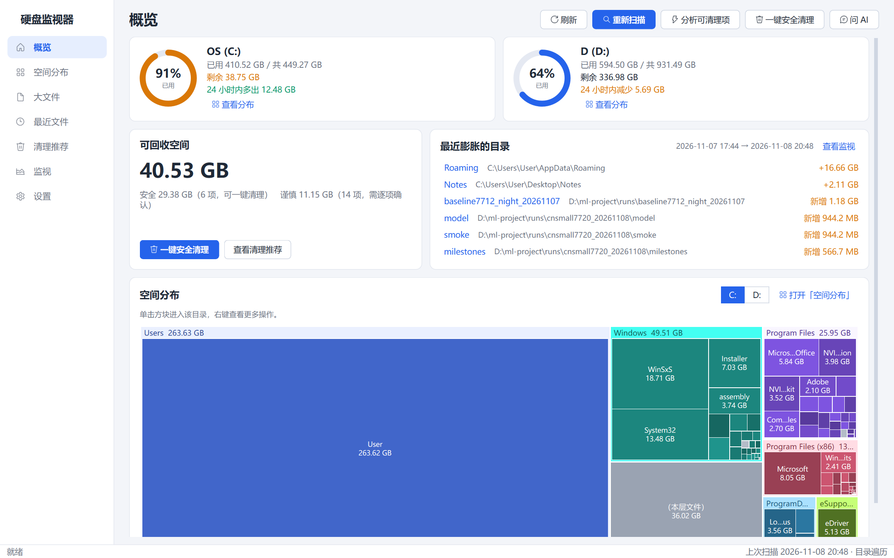
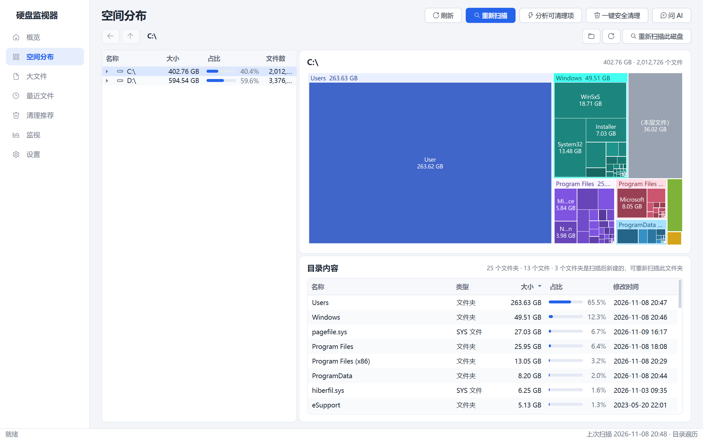
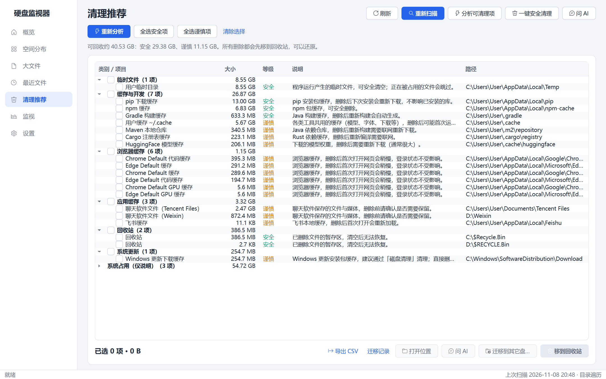
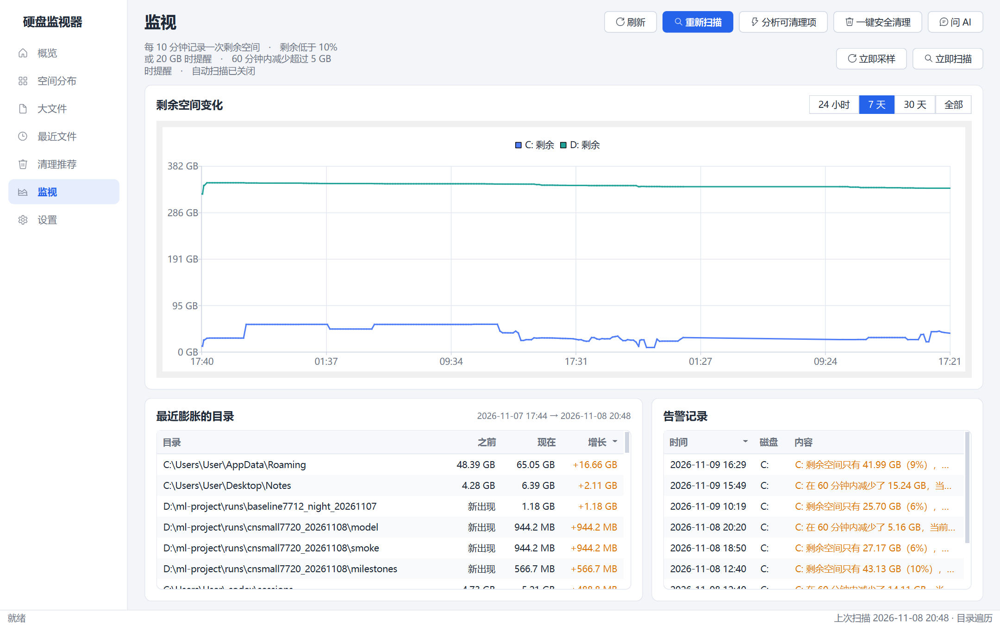
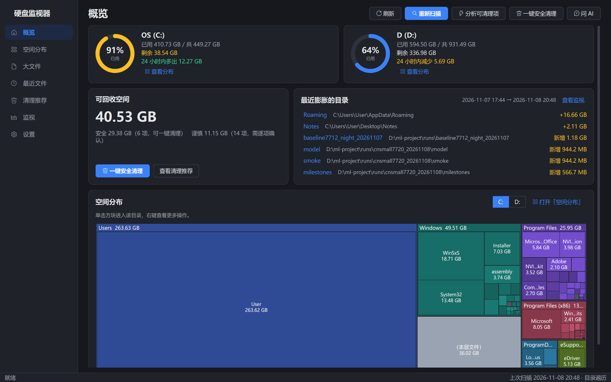

<div align="center">

# 硬盘监视器 · HardDriveMonitor

**C 盘又红了？一眼看清空间被谁吃掉，安全地把它要回来。**

一个开源、离线、不装后台服务的 Windows 磁盘空间分析与清理工具。

[](https://github.com/wxx827/HardDriveMonitor/releases/latest)




</div>

---

## 为什么做这个

Windows 自带的「存储」只告诉你“其他 120 GB”，资源管理器一层层点文件夹属性又慢又累。
硬盘监视器把整盘扫一遍、建好索引，之后**秒开、实时更新**，回答三个问题：

1. **空间去哪了？** —— Treemap 一眼看出哪个目录最大，层层下钻。
2. **最近谁在偷偷变大？** —— 定时记录剩余空间，对比两次扫描找出膨胀的目录，空间不足自动提醒。
3. **什么能安全删？** —— 按规则识别缓存、临时文件、旧安装包、重复文件，标好「安全 / 谨慎 / 不建议」，删除一律进回收站。

## 亮点

- ⚡ **快**：多进程并行遍历，实测 C + D 两盘约 **540 万个文件、1.07 TB，1～3 分钟扫完**；以管理员运行时直接顺序读取 NTFS 主文件表（MFT），不逐个打开目录，速度更快。
- 🔄 **索引实时跟随**：监听文件增删，在资源管理器里删个文件，几秒内统计就同步，不用重新扫描。
- 🗺️ **空间分布**：懒加载目录树 + Squarified Treemap，点方块直接进入该目录。
- 🧹 **清理推荐**：pip / npm / Gradle / Maven / conda / HuggingFace 缓存、浏览器缓存、微信 / QQ / 飞书缓存、Windows 更新缓存、旧安装包、重复文件、`node_modules` 等，一键清理「安全」项。
- 📦 **C 盘大目录迁移**：把大目录复制到其它盘，并在原位置建立目录联接（junction），**原路径照常可用**；任何一步失败自动回滚。
- 📈 **监视与告警**：剩余空间历史曲线，低于阈值或短时间内骤降时托盘通知；可开机自启、最小化到托盘。
- 🤖 **AI 助手**：右侧边栏，不联网也能回答「C 盘为什么满了」「哪些能安全删」「最近什么变大了」「能迁移什么到 D 盘」「pagefile.sys 能删吗」这类问题，会一路钻到具体是哪个文件夹占的空间；接入 DeepSeek / 通义千问 / Kimi / 智谱 / OpenAI / Ollama 等 OpenAI 兼容接口后可以自由提问。
- 🌗 浅色 / 深色主题，Fluent 风格界面。

## 截图

| 空间分布 | 清理推荐 |
|---|---|
|  |  |
| **监视** | **深色主题** |
|  |  |

## 下载使用

### 方式一：直接下载 exe（推荐）

到 [Releases](https://github.com/wxx827/HardDriveMonitor/releases/latest) 下载 `HardDriveMonitor.exe`（约 59 MB），放进一个单独的文件夹里双击运行即可，**不需要安装 Python**。

- 程序把索引和设置保存在 exe 旁边的 `data\` 文件夹里，绿色免安装，删掉文件夹就卸载干净。
- 想用 MFT 极速扫描：在「设置」里点「以管理员身份重新启动」。
- 首次运行 Windows SmartScreen 可能提示“未知发布者”，点「更多信息 → 仍要运行」。

### 方式二：从源码运行

需要 Windows 10/11 和 Python 3.10+。

```powershell
git clone https://github.com/wxx827/HardDriveMonitor.git
cd HardDriveMonitor
pip install -r requirements.txt
python app.py
```

也可以直接双击 `启动.bat`，它会自动检查并安装依赖。

## 功能一览

| 页面 | 能做什么 |
|---|---|
| 概览 | 各盘占用、24 小时变化、可回收空间、最近膨胀的目录、整盘 Treemap |
| 空间分布 | 目录树 + Treemap + 当前目录内容，右键打开 / 复制路径 / 迁移 / 删除 |
| 大文件 | 按盘符、大小（≥100 MB～≥5 GB）、类型、关键字筛选，上万行虚拟表格不卡顿 |
| 最近文件 | 最近 N 天新增或修改的文件，找出“是什么突然占了空间” |
| 清理推荐 | 分类勾选清单，标注安全等级与理由，可导出 CSV |
| 监视 | 剩余空间曲线、两次扫描间增长最多的目录、告警记录 |
| 设置 | 扫描盘符与方式、自动扫描、告警阈值、托盘与开机自启、AI 服务商、主题 |

快捷键：`F5` 刷新，`Ctrl+R` 重新扫描，`Ctrl+J` 打开 AI 助手，`Ctrl+1～7` 切换页面。

## 安全与隐私

- **只读元数据**：扫描只读文件名、大小、修改时间和属性，不打开、不读取文件内容。
- **删除可撤销**：所有删除都先进回收站；删除前二次确认数量、大小和等级。
- **硬拦截**：系统目录、`pagefile.sys`、磁盘根目录、本程序目录在代码层禁止删除，「不建议」项无法勾选。
- **默认离线、无遥测**：只有你主动使用 AI 并配置了服务时才会联网，发送的也只是路径和大小等元数据，用户名默认替换为 `<用户>`。
- **API Key 加密**：使用 Windows DPAPI 加密保存，只有当前 Windows 账户能解密。

## 项目结构

```
app.py            入口：单实例、托盘启动、崩溃日志
core/             核心逻辑（不依赖界面）
  scanner.py      多进程目录遍历
  mft.py          NTFS MFT 直读扫描
  index.py        SQLite 索引（WAL，读写分离）
  watch.py        ReadDirectoryChangesW 文件变动监听
  sync.py         增量同步，只更新变动的目录
  recommend.py    清理规则
  cleanup.py      受保护路径校验 + 回收站删除
  migrate.py      robocopy + junction 大目录迁移（失败回滚）
  monitor.py      空间采样、告警、开机自启
  ai.py           离线规则报告 + OpenAI 兼容流式客户端
ui/               PySide6 界面（页面、组件、主题、托盘）
tests/            单元测试
scripts/          打包与截图脚本
```

## 开发

```powershell
python -m unittest discover -s tests      # 运行测试（142 个）
powershell -ExecutionPolicy Bypass -File scripts\build.ps1   # 打包成 dist\硬盘监视器.exe
```

欢迎提 Issue 和 PR：新的清理规则、更多软件的缓存目录、界面改进都很需要。

## 许可证

[MIT](LICENSE)
